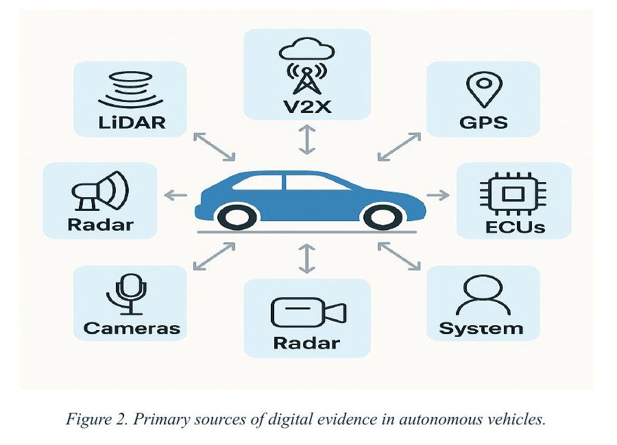
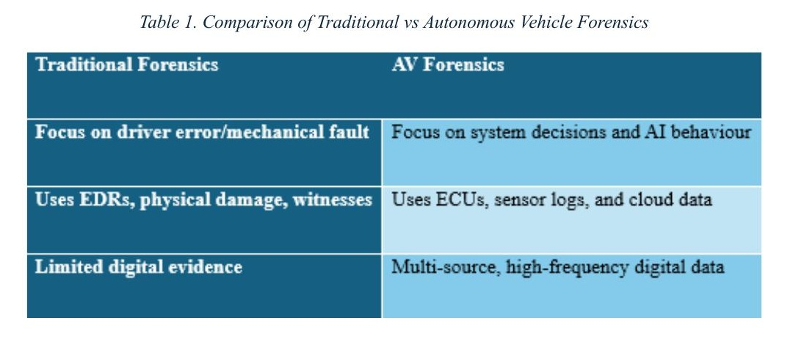
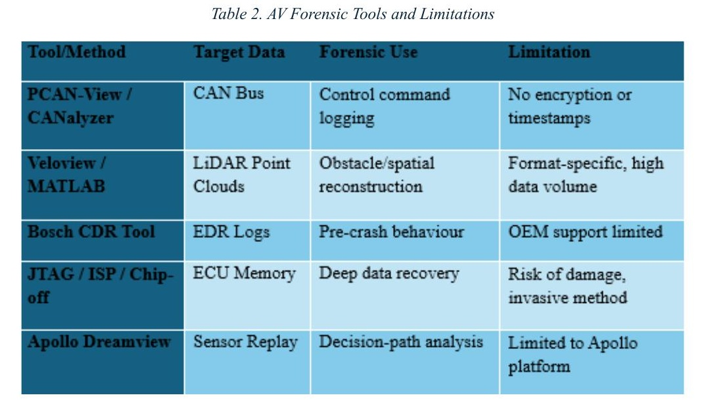
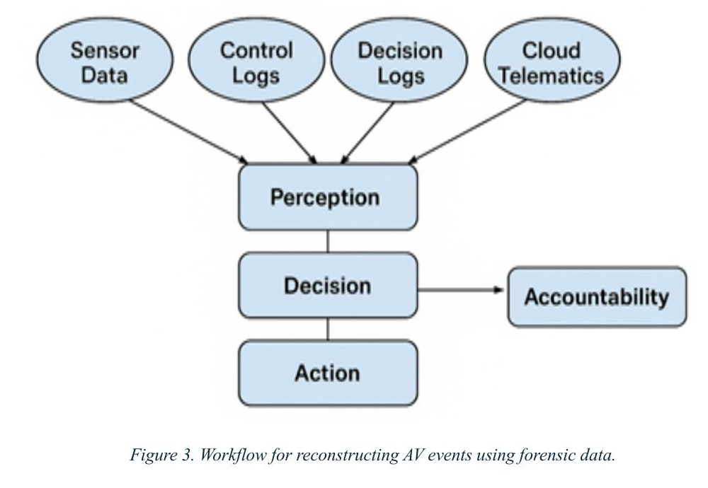
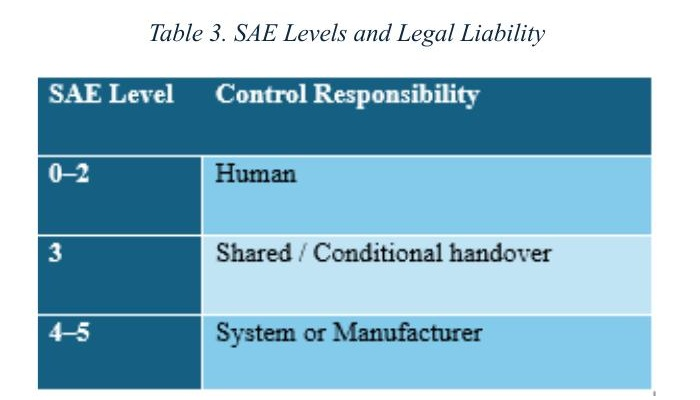
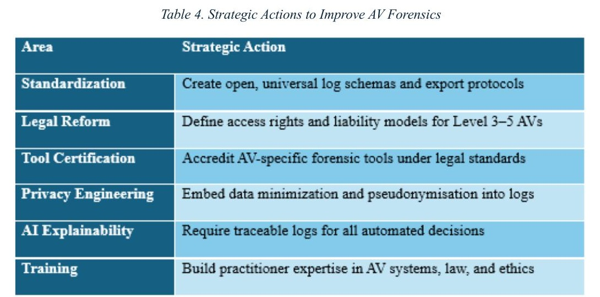

# Autonomous Vehicle Forensics: Reconstructing Events and Establishing Accountability

When a self-driving car crashes, who is at fault, and can you even prove it? That question is what this research report set out to answer. Traditional vehicle forensics leans on physical damage, witness statements and a basic event data recorder. None of that tells you much when the thing making the decisions is a neural network reading LiDAR point clouds.

This is a research and analysis report rather than a lab build. No hands-on acquisition was performed.

## The problem

An autonomous vehicle generates evidence across a lot of separate systems at once: LiDAR, radar, GPS, cameras, electronic control units talking over the CAN bus, and V2X communications with other vehicles and roadside infrastructure. Investigating an incident means pulling all of that together into one timeline.

That turns out to be harder than it sounds. The data is scattered across subsystems, each manufacturer uses its own proprietary format, a lot of it sits in volatile memory and vanishes if nothing triggers a save, and almost none of these systems were designed with a forensic investigation in mind.

## Tools, and where they fall short

I reviewed the tooling currently used to extract and interpret this data, including CAN bus analysers (PCAN-View, CANalyzer), LiDAR and sensor replay tools (Veloview, MATLAB, Apollo Dreamview), EDR extraction via the Bosch CDR tool, and invasive chip-off/JTAG recovery from ECU memory.

The pattern across all of them is the same: each is tied to a specific data format or vendor platform, most offer no cryptographic sealing or chain-of-custody guarantees, and several depend on the manufacturer choosing to cooperate. AVGuard was the most promising thing I found, since it proposes cryptographically sealed logging, but it still needs cloud support and OEM buy-in to work.

## Reconstructing what happened

Event reconstruction in an AV means tracing a path from raw sensor input, through how the system perceived the situation, to the decision it made and the action it took. Only once you can follow that chain can you say anything meaningful about accountability.

The reconstruction breaks down in practice for predictable reasons: logs from different subsystems are out of sync or missing entirely, data gets encrypted or overwritten, and proprietary formats block anyone outside the manufacturer from verifying the analysis independently. The 2018 Uber AV fatality is a clear example, where missing decision logs limited what investigators could establish.

## Who is liable

Responsibility shifts as automation increases. At SAE levels 0 to 2 the human is driving. At level 3 it is a conditional handover. At levels 4 and 5 the system is in control, and under the UK's No-User-In-Charge concept, legal responsibility moves to the operator or manufacturer.

That creates a gap. If liability sits with the manufacturer, but the manufacturer also controls the only copy of the evidence and the only tooling that can read it, independent verification becomes very difficult. Several Tesla Autopilot cases show investigators working from company-provided summaries instead of raw logs.

## Legal and privacy tensions

AV log data is contested ground. Manufacturers claim intellectual property rights over it, users claim privacy rights, and cloud providers hold the storage. Under GDPR a user can request erasure of their data, which runs directly against the forensic need to retain and preserve evidence.

There is also an admissibility problem. Courts expect evidence to be verifiable and independently accessible. AV data frequently fails that test because it sits in a proprietary format, has no cryptographic sealing, was extracted with uncertified tooling, or has been through cloud syncing that muddies where it originated.

## What would fix this

The core argument of the report is forensic-by-design: building AVs so that investigation is possible from the start, rather than trying to retrofit it after a crash. In practice that means decision-path logs, reliable real-time timestamps, open file formats, and synchronised cloud and local storage.

## Conclusion

Current forensic practice is not equipped for autonomous vehicles. The combination of AI decision-making, volatile sensor data, encrypted proprietary logs and cloud dependency means investigations are often incomplete, and what evidence does exist may not survive legal scrutiny. Without standardised formats and regulatory pressure toward forensic readiness, AV investigations will keep depending on the cooperation of the party with the most to lose from them.

## Topics covered

Autonomous vehicle forensics, CAN bus and ECU analysis, LiDAR and sensor data reconstruction, event data recorders, chain of custody, evidence admissibility, GDPR and data ownership, SAE automation levels and liability, AI explainability, forensic-by-design.

## Evidence

Full-size figures and tables are in [`figures/`](./figures).
